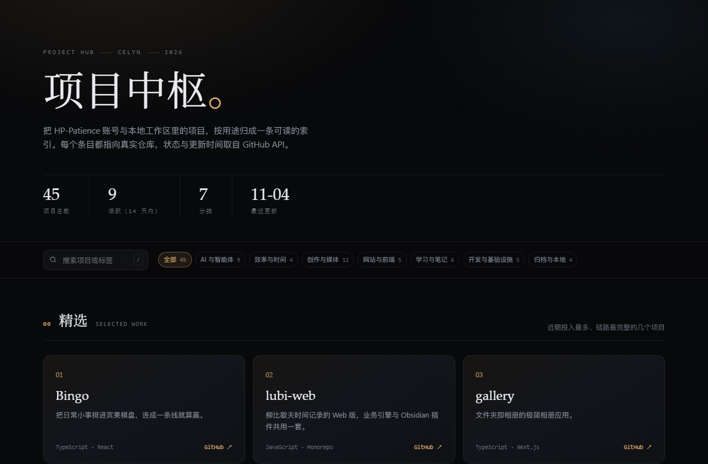

<div align="center">

# 项目中枢 · Project Hub

把 HP-Patience 账号与本地工作区里的项目，按用途归成一条可读的索引。



[**在线浏览 →**](https://hp-patience.github.io/Project_Hub/) · [个人主页](https://github.com/HP-Patience)

<sub>45 个项目 · 7 个分类 · 9 个近 14 天活跃 · 最近更新 2026-11-04</sub>

</div>

---

## 分类概览

| 分类 | 数量 | 说明 |
| --- | --- | --- |
| AI 与智能体 | 9 | 把模型能力落成可用工具：Agent 工作流、技能库、检索与生成。 |
| 效率与时间 | 4 | 任务、时间、知识的管理系统，多数以本地数据与 Markdown 为底座。 |
| 创作与媒体 | 12 | 图像、声音、视频与游戏：从素材检索到成片输出的完整链路。 |
| 网站与前端 | 5 | 个人主页、内容工作台与前端练习，多为可直接访问的线上作品。 |
| 学习与笔记 | 6 | 课程、教材与研究方向的结构化记录，强调可复习、可追踪。 |
| 开发与基础设施 | 5 | 编辑器、桥接层、脚本与配置：支撑上面所有项目的底座。 |
| 归档与本地 | 4 | 远程已删除、仅本地保留或上游参考版本，不作为活跃项目维护。 |

状态说明：**活跃** 14 天内推送 · **维护中** 90 天内 · **暂缓** 超过 90 天 · **上游衍生** 基于他人项目二次开发 · **已归档** 停止维护 · **仅本地** 未发布到远程。

### AI 与智能体 · AI & Agents

把模型能力落成可用工具：Agent 工作流、技能库、检索与生成。

| 项目 | 说明 | 技术栈 | 状态 | 最近更新 |
| --- | --- | --- | --- | --- |
| genius-mathmodelagent | **对 Modex-MH-Agent 科研助手的逆向分析与结构备份。** 整理后端服务、工作流编排、技能系统与桌面端结构，作为自建科研 Agent 的参考实现。 | Python · Agent | 仅本地 | 2026-11-04 |
| [DeepTutor](https://github.com/HP-Patience/DeepTutor) | **结合知识库检索的个性化 AI 学习助手。** 在 HKUDS/DeepTutor 基础上做个人化调整：答疑、课程学习与知识理解，支持文档入库检索。 | Python · RAG · Agent | 上游衍生 | 2026-11-01 |
| [Skills](https://github.com/HP-Patience/Skills) | **面向 AI 编程助手的个人 Agent Skills 合集。** 覆盖学习、写作、规划、需求理解与开发工作流，按可安装的 skill 结构组织。 | Python · Markdown | 活跃 | 2026-10-26 |
| [MathModelAgent](https://github.com/HP-Patience/MathModelAgent) | **数学建模 Agent：从读题到生成可提交的完整论文。** 问题分析、建模求解、代码执行与论文撰写串成一条链路，支持知识库与人机协作。 | Python · Agent | 上游衍生 | 2026-10-25 |
| [tongflow](https://github.com/HP-Patience/tongflow) | **多模态 AI 工作流：用节点编排文本、图像、语音与视频。** 可视化画布组织生成流程，节点间可组合模型与参数，适合把一次性脚本固化成可复用管线。 | TypeScript · React | 上游衍生 | 2026-10-11 |
| [tongflow-api-xai](https://github.com/HP-Patience/tongflow-api-xai) | **TongFlow 的 xAI Grok 节点插件。** 通过 OpenAI 兼容接口接入聊天、视觉与图像模型，支持逐节点选择模型。 | Python · xAI | 上游衍生 | 2026-10-09 |
| [GithubStarsManager](https://github.com/HP-Patience/GithubStarsManager) | **把 GitHub Star 变成可检索、可分类的个人资料库。** 自动同步星标仓库，用 AI 生成摘要与分类，支持语义搜索与 Release 追踪。 | TypeScript · LLM | 上游衍生 | 2026-09-07 |
| [dsh-directorx](https://github.com/HP-Patience/dsh-directorx) | **DeepSeek Harness 插件：视频、图像、音频技能与知识库。** 为本地 Agent 挂载多模态工具与可配置模型，适合做内容生产流水线。 | JavaScript · DeepSeek | 上游衍生 | 2026-09-03 |
| [writing-dna-skill](https://github.com/HP-Patience/writing-dna-skill) | **写作蒸馏器：把任意写作风格提炼成可复用的 Agent 技能。** 从样本文本中提取语言、结构与素材策略，产出可直接装载的 skill，作为 Skills 仓库的上游参考。 | Markdown · Agent | 上游衍生 | 2026-08-24 |

### 效率与时间 · Productivity

任务、时间、知识的管理系统，多数以本地数据与 Markdown 为底座。

| 项目 | 说明 | 技术栈 | 状态 | 最近更新 |
| --- | --- | --- | --- | --- |
| [Bingo](https://github.com/HP-Patience/Bingo) | **把日常小事排进宾果棋盘，连成一条线就算赢。** React + Supabase 的宾果式任务管理：完成格子攒 XP、升级解锁头衔，用抽奖与虚拟商店把奖励兑换成真实的休息与零食。 | TypeScript · React · Supabase | 活跃 | 2026-11-04 |
| [lubi-web](https://github.com/HP-Patience/lubi-web) | **柳比歇夫时间记录的 Web 版，业务引擎与 Obsidian 插件共用一套。** monorepo（apps + packages），把时间轴记录、计时、周月年回顾与备份搬进浏览器，数据留在本机 SQLite。 | JavaScript · Monorepo · SQLite | 活跃 | 2026-11-04 |
| [obsidian_task_kanban](https://github.com/HP-Patience/obsidian_task_kanban) | **Lubi 时间记录插件，外加一份开箱即用的 Obsidian 仓库。** 时间轴记录、周/月/年回顾与热力图、周日程任务规划，全部落在纯 Markdown 上，可直接 git 同步。 | TypeScript · Obsidian | 活跃 | 2026-11-02 |
| [Obsidian_Plugin](https://github.com/HP-Patience/Obsidian_Plugin) | **个人 Obsidian 插件源码合集：Lubi 与 Mermaid Zoom Viewer。** 两个自用插件的源码与构建脚本集中管理，方便统一版本与发布。 | JavaScript · Obsidian | 活跃 | 2026-11-02 |

### 创作与媒体 · Creative & Media

图像、声音、视频与游戏：从素材检索到成片输出的完整链路。

| 项目 | 说明 | 技术栈 | 状态 | 最近更新 |
| --- | --- | --- | --- | --- |
| [gallery](https://github.com/HP-Patience/gallery) | **文件夹即相册的极简相册应用。** 把图片放进 public/albums 即自动生成相册列表，响应式瀑布流浏览，桌面与移动端均适配。 | TypeScript · Next.js | 活跃 | 2026-11-04 |
| [ink-live2d](https://github.com/HP-Patience/ink-live2d) | **墨像：黑白肖像与键鼠桌宠共用一套 Live2D 制作管线。** InkPortrait 与 InkKeys 两个模型合并维护，包含分层工具、绑定导出与运行验证流程。 | Python · Live2D | 活跃 | 2026-11-02 |
| [LocalMediaSearch](https://github.com/HP-Patience/LocalMediaSearch) | **镜库：用一句话或一张参考图，找到本机里的素材。** 基于 EmbeddingGemma 2 的本地多模态检索，覆盖视频、图片、音频、文本与代码，定位后可导出。 | Python · Embedding · Windows | 维护中 | 2026-10-12 |
| [MusiCue](https://github.com/HP-Patience/MusiCue) | **听得懂心情的 AI 电台，按场景生成渐进式歌单。** 用自然语言描述需求，模型结合上下文推荐歌曲并持续记忆品味，形成个人 DJ。 | TypeScript · React · LLM | 维护中 | 2026-08-29 |
| ink-bongocat-live2d | **基于 SDL3 + OpenGL 的 BongoCat 桌面宠物。** 把 Live2D 模型放进轻量原生窗口，跟随键鼠输入做互动，作为桌宠运行时的试验田。 | C · SDL3 · OpenGL | 仅本地 | 2026-11-03 |
| video-parser | **本地视频资料工作台：下载、抽帧、字幕、转写与归档。** 链接解析下载后串起封面抽帧、B 站字幕、Whisper CUDA 批量转写与 AI 画面分析，提供 React 界面与 Python CLI。 | Python · React · Whisper | 仅本地 | 2026-10-29 |
| [voicebox](https://github.com/HP-Patience/voicebox) | **本地 AI 语音工作室：克隆、合成、听写与 Agent 接口。** 把声音克隆、多语言语音合成与快捷键听写收进一个桌面应用，并提供给 Agent 调用的语音接口。 | TypeScript · TTS | 上游衍生 | 2026-09-19 |
| [openscreen](https://github.com/HP-Patience/openscreen) | **免费做演示视频：无订阅、无水印，可商用。** 屏幕录制与镜头编排工具，面向产品演示与操作讲解，作为 Screen Studio 的替代。 | TypeScript · Electron | 上游衍生 | 2026-09-19 |
| [VoxCPM](https://github.com/HP-Patience/VoxCPM) | **无分词器的多语言语音合成，支持音色设计。** 在上游模型基础上做本地化实验：多语言生成、创意音色设计与可控声音克隆。 | Python · TTS | 上游衍生 | 2026-09-14 |
| [pix](https://github.com/HP-Patience/pix) | **面向游戏开发的 AI 像素资产平台。** 整合图像生成、去背景、限色、序列帧处理与资产管理，输出可直接进引擎的像素素材。 | Python · FastAPI · React | 上游衍生 | 2026-09-10 |
| [ember-covenant-sanctuary](https://github.com/HP-Patience/ember-covenant-sanctuary) | **《烬契圣堂》：高对比像素风俯视角动作肉鸽原型。** 自由瞄准射击、净焰脉冲与双面契印构成核心循环，圣堂地图按房间推进。 | JavaScript · Canvas | 维护中 | 2026-09-05 |
| [video-subtitle-remover](https://github.com/HP-Patience/video-subtitle-remover) | **AI 去除视频硬字幕与水印，保持原始分辨率。** 支持自定义区域、批量图片与三平台运行，适合处理二创素材与教学录屏。 | Python · CV | 上游衍生 | 2026-06-30 |

### 网站与前端 · Web & Frontend

个人主页、内容工作台与前端练习，多为可直接访问的线上作品。

| 项目 | 说明 | 技术栈 | 状态 | 最近更新 |
| --- | --- | --- | --- | --- |
| resume-website | **中英双语的响应式简历与作品展示页。** 静态模板，支持语言切换与移动端适配，附 PDF 版本下载。 | HTML · CSS | 仅本地 | 2026-11-04 |
| frontend-awesome-collection | **优秀前端作品的收藏与复刻实践。** 收录网站、交互组件与视觉动效，附设计拆解笔记与可运行复刻版本。 | HTML · CSS · JavaScript | 仅本地 | 2026-11-04 |
| [HP-Patience](https://github.com/HP-Patience/HP-Patience) | **GitHub 个人主页：AI 产品、学习系统与个人工具。** Profile 仓库，用 README 组织项目索引与自我介绍。 | Python · Markdown | 维护中 | 2026-10-12 |
| [OpenStock](https://github.com/HP-Patience/OpenStock) | **开源美股行情分析应用，Next.js + shadcn/ui。** 接入 Finnhub 行情与 TradingView 图表，作为付费行情终端的替代方案。 | TypeScript · Next.js | 上游衍生 | 2026-10-06 |
| [Firefly_Hub](https://github.com/HP-Patience/Firefly_Hub) | **博客的本地内容工作台：写、预览、发布一条龙。** 集中管理文章与动态，Markdown 实时预览，并协作源码仓库与静态构建仓库的提交流程。 | JavaScript · Electron | 维护中 | 2026-08-29 |

### 学习与笔记 · Learning & Notes

课程、教材与研究方向的结构化记录，强调可复习、可追踪。

| 项目 | 说明 | 技术栈 | 状态 | 最近更新 |
| --- | --- | --- | --- | --- |
| [English_Context](https://github.com/HP-Patience/English_Context) | **把 6098 个考研词汇放进连续故事里记。** 118 个分类结合 AI 释义与例句，用语境理解 + SM-2 间隔复习把单词变成长期记忆。 | TypeScript · React · LLM | 维护中 | 2026-10-08 |
| mao-probability-statistics | **以茆诗松教材为主线的概率统计学习记录。** 按定义、定理、证明与习题跟踪掌握程度，配合复习进度表。 | Python · Markdown | 仅本地 | 2026-11-04 |
| [course-work](https://github.com/HP-Patience/course-work) | **MIT Missing Semester 与零到全栈的课程材料归档。** 按课程模块整理配套代码与笔记，保留可回看的练习痕迹。 | CSS · Markdown | 活跃 | 2026-11-02 |
| [worldquant-study-note](https://github.com/HP-Patience/worldquant-study-note) | **WorldQuant BRAIN 的量化研究笔记与实验记录。** 从 Alpha Research、表达式写法到回测设置，记录实验、结果解读与提交准备。 | Markdown | 维护中 | 2026-09-24 |
| [my-fullstack-journey](https://github.com/HP-Patience/my-fullstack-journey) | **从零基础到 AI Agent 产品的全栈学习路线。** 覆盖 Python、JavaScript、React、FastAPI、数据库、LLM 与 Agent 开发的阶段性笔记。 | Markdown | 维护中 | 2026-09-19 |
| [DevPatterns](https://github.com/HP-Patience/DevPatterns) | **开发模式与工程实践笔记库。** 前后端架构、工具配置、AI 工作流与项目管理方法的个人沉淀。 | Markdown | 暂缓 | 2026-06-25 |

### 开发与基础设施 · Dev & Infra

编辑器、桥接层、脚本与配置：支撑上面所有项目的底座。

| 项目 | 说明 | 技术栈 | 状态 | 最近更新 |
| --- | --- | --- | --- | --- |
| [Tools](https://github.com/HP-Patience/Tools) | **日常 AI 小工具集合，全部可独立运行。** 包含 LLM 接口连通性与响应速度测试、AI 绘图等本地小工具，按单文件组织便于随手启动。 | HTML · Python | 活跃 | 2026-11-04 |
| open_shuncode | **基于 Code-OSS 的 AI 编辑器，附带远程 MCP 桥接。** 支持原生智能体与多模型协作，并让网页端 AI 通过 MCP 操作本地项目。 | TypeScript · Code-OSS · MCP | 仅本地 | 2026-11-04 |
| [dotfiles](https://github.com/HP-Patience/dotfiles) | **Linux 服务器的 Zsh 配置与一键安装脚本。** Powerlevel10k 主题、常用插件与安装脚本，保证新机器十分钟内可用。 | Shell · Zsh | 维护中 | 2026-08-31 |
| [github-readme-stats](https://github.com/HP-Patience/github-readme-stats) | **README 统计卡片的自建实例。** 上游项目的个人部署副本，用于在主页 README 中生成动态统计图，保持数据自持。 | JavaScript · Vercel | 上游衍生 | 2026-07-31 |
| [api-enhanced](https://github.com/HP-Patience/api-enhanced) | **网易云音乐 API 的增强版服务。** 在上游基础上补齐接口与兼容层，为本地音乐类项目提供统一数据源。 | JavaScript · Node.js | 上游衍生 | 2026-06-09 |

### 归档与本地 · Archive & Local

远程已删除、仅本地保留或上游参考版本，不作为活跃项目维护。

| 项目 | 说明 | 技术栈 | 状态 | 最近更新 |
| --- | --- | --- | --- | --- |
| Project_Data_Archive | **项目数据与附件的本地归档仓，仅本地保留。** 集中存放不便入库的素材、导出与备份文件，未推送到远程。 | Archive | 仅本地 | 2026-11-04 |
| obsidian-kaoyan | **考研向 Obsidian vault，含笔记与附件。** 545 MB / 10,422 文件的主 vault，笔记与附件混存，尚未完成瘦身与 LFS 迁移。 | Markdown · Obsidian | 仅本地 | 2026-11-04 |
| obsidian-config | **Obsidian 配置快照：插件、主题与工作区布局。** 只备份 .obsidian 目录，不含笔记与附件，用于快速还原编辑环境。 | JSON · Obsidian | 仅本地 | 2026-11-04 |
| folia-major | **Folia 音乐播放器的本地副本（上游参考）。** 歌词与播放体验做得较完整的上游项目，本地保留用于界面与交互参考。 | TypeScript | 仅本地 | 2026-10-05 |

---

## 仓库结构

```
Project_Hub/
├─ data/projects.json     # 唯一数据源：分类与项目条目
├─ templates/index.html   # 页面模板（含样式与交互）
├─ build.py               # 生成 index.html 与 README.md
├─ index.html             # 生成产物，GitHub Pages 入口
└─ README.md              # 生成产物，本文件
```

## 维护方式

1. 在 `data/projects.json` 增加或修改条目（`category` 必须是 `categories` 里已有的 id）。
2. 运行 `python build.py` 重新生成页面与 README。
3. 提交并推送，Pages 自动更新。

字段约定：`name` `owner` `category` `tagline`（一句话）`desc`（两三句）`stack` `tags` `updated`；可选 `homepage` `featured` `statusOverride`（`fork` / `archived` / `local`）。状态默认由 `updated` 推算。

<sub>生成时间 2026-11-04 20:26 · 数据来源 GitHub REST API 与本地工作区</sub>
